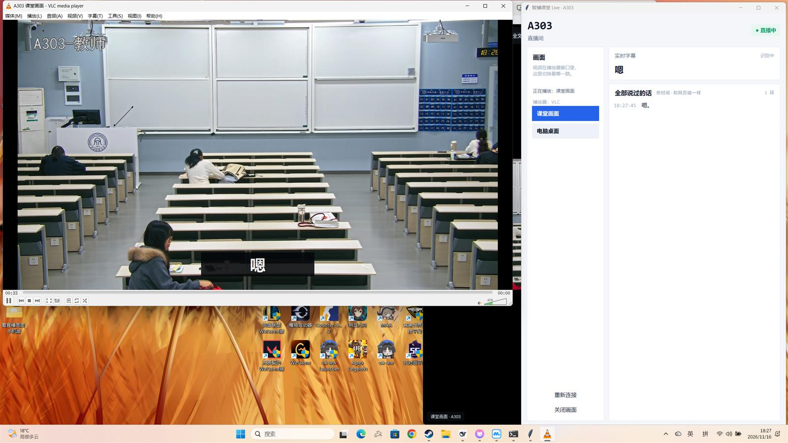
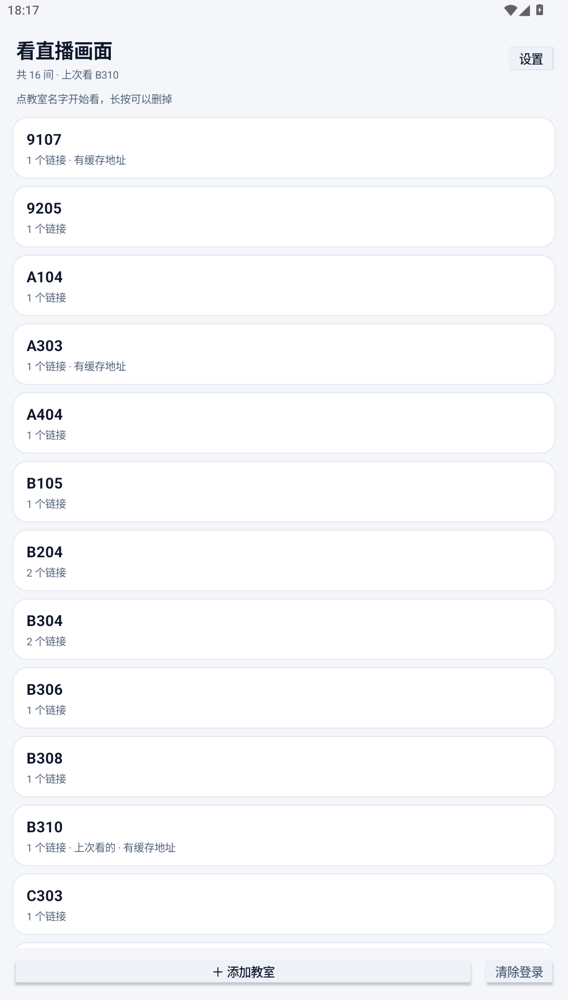
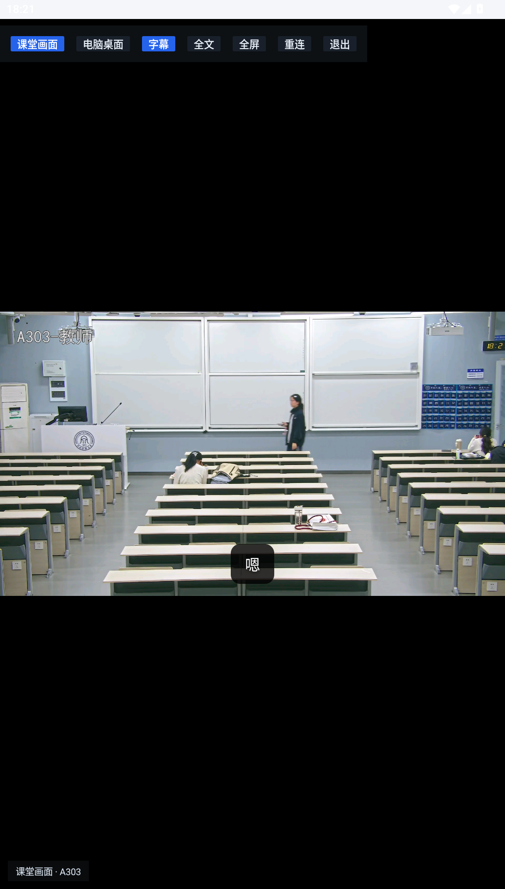

# 智播课堂 Live · 三种形式看真实直播画面

浙江财经大学「智播课堂」（`psp-zelda.chaoxing.com/vri-zelda/*`）的非官方小工具，一个仓库三种形态：

| 形式 | 装在哪 | 适合谁 | 入口 |
| :--- | :--- | :--- | :--- |
| **① 油猴脚本（插件）** | 浏览器 | 想直接在直播页看、不动电脑 | [`zufe-live-restore.user.js`](zufe-live-restore.user.js) |
| **② 电脑端** | Windows | 想开个独立窗口，边看边看字幕转写 | [`desktop/`](desktop/) |
| **③ 手机端 APK** | Android 7.0+ | 躺床上 / 不在电脑前 | [`android/智播课堂Live.apk`](android/%E6%99%BA%E6%92%AD%E8%AF%BE%E5%A0%82Live.apk) |

三个都一样：**页面显示「直播已结束」时，仍然把真实的直播画面放出来**，而且带声音。



---

## 本次更新（v0.5.0 · 首次带电脑端和手机端）

这一版把「只能看画面」补成了「看得见、也听得懂」：

### 1. 实时字幕 + 全文转写（电脑端、手机端都有）

- **画面底部的字幕条**：显示学校 AI 转写*正在说的那句话*（`last_mid_text`），黑底白字、居中、宽度随文字长短伸缩，贴在画面底边，不会挡住播放器操作。
- **右侧「全部说过的话」**：和网页版一样的转写记录，一句一行，前面带 `时:分:秒`，新句子自动滚到底，标题右边显示「N 段」。
- **开关**：电脑端在播放窗底部有「字幕条」开关（关掉只隐藏浮层，右侧记录照常）；手机端顶部有「字幕」「全文」两个按钮。
- 数据来源：`/vri-zelda/api/live-ts`（`live_url` + `enc` + `offset_id` + `start_time` + `fid` + `speechid`，1～1.5 秒轮询一次，只回增量）。这个接口**不需要登录 cookie**，但要带浏览器 UA 和 `Referer`，否则 403。
- 学校端识别有延迟，一般比老师开口慢十秒左右；没有开 AI 转写的课，两边都没有内容——不是程序坏了。

### 2. 界面重做：浅色、简约

- 电脑端从 tkinter 默认灰色换成了浅色主题（`#F4F6FA` 背景 + 白色卡片 + `#2563EB` 主色），字体分开用：中文 `Microsoft YaHei UI`、数字/房间号 `Consolas`、西文 `Segoe UI`。
- 选教室从 Listbox 换成了**三列卡片**（搜索、悬停高亮、双击直接看）；播放窗改成**左边画面 + 右边字幕**的并排布局，启动后自动把 VLC 摆到左边。
- 手机端同步换浅色主题（Material Light + 白色卡片圆角），播放页顶部是一排胶囊按钮，字幕条浮在视频画面上。

### 3. 改名

原来的「看直播画面/独立版」统一改成 **智播课堂 Live**（包名 `com.zufe.liveview` 不变，覆盖安装不丢数据）。

### 4. 其它

- 手机端播放器从 `SurfaceView` 换成 `TextureView`：否则视频层会盖住字幕条和右侧面板。
- 电脑端修了字幕条定位（无边框窗口必须先 `deiconify` 再 `geometry`，否则位置被忽略）和 VLC 置顶抢层级（加 `--no-video-on-top`）的问题。
- 手机端版本 1.0.0 → 1.1.0（versionCode 2）。

---

## ① 油猴脚本（浏览器插件）

装一次，之后自动更新。

1. 给 Edge/Chrome 装 **Tampermonkey**
   - Edge 商店：<https://microsoftedge.microsoft.com/addons/detail/iikmkjmpaadaobahmlepeloendndfphd>
2. **新版 Edge 必须额外开一步**：`edge://extensions/` → Tampermonkey → 详细信息 → 打开 **「允许用户脚本」**
3. 点这个链接安装：
   <https://raw.githubusercontent.com/quiter1/zufe-live-restore/main/zufe-live-restore.user.js>
4. 打开直播间页面，页面右下角出现 `[直播恢复] …` 就是好了；画面默认静音，点一下画面开声音。

细节（原理、调试 `&zufe_debug=1`、自动更新机制、已知限制）见脚本本身与 [更新记录](#更新记录)。

## ② 电脑端（Windows）

1. 下载整个 [`desktop/`](desktop/) 文件夹，和 `runtime\python`、`vlc\` 一起放（**直接用桌面那个完整文件夹打包发给别人最简单**）。
2. 双击 `智播课堂Live.bat`（旧的 `看直播.bat` 也能用）。
3. 第一次点教室会提示登录：要么在自动弹出的 Edge 里扫码/输密码，要么先在【账号设置】里填一次超星账号密码。
4. 第一次播放会自动下载 VLC（约 79 MB，官方源失败换清华镜像，校验 SHA256）。

取流顺序：`browser-profile` 里的登录态 → 账号密码 → 弹浏览器登录。

详细说明见 [`desktop/使用说明.txt`](desktop/使用说明.txt)。

**用到的文件**

```
desktop/
  智播课堂Live.bat   启动入口
  watch_live.py      取流 + 登录 + 播放器调度
  ui_windows.py      界面：选教室窗口 / 播放窗口 / 底部字幕条
  ui_kit.py          浅色主题控件（卡片、按钮、开关、滚动列表）
  subtitles.py       AI 转写客户端（轮询 live-ts）
  cdp_min.py         极小 WebSocket/CDP 客户端（浏览器登录用）
  使用说明.txt
```

## ③ 手机端 APK（Android）

1. 把 [`android/智播课堂Live.apk`](android/%E6%99%BA%E6%92%AD%E8%AF%BE%E5%A0%82Live.apk) 传到手机安装（允许「安装未知应用」）。
2. 首次点教室：设置里填账号密码自动登录，或按提示「去登录」在页面里登一次。
3. 播放页顶部：`课堂画面 / 电脑桌面 / 字幕 / 全文 / 全屏 / 重连 / 退出`；点画面可收起按钮栏。




- 包名 `com.zufe.liveview`，版本 1.1.0，minSdk 24 / targetSdk 34，签名自签（`CN=LiveView`）。
- 源码在 [`android/`](android/)（Gradle 8.9 + AGP 8.7.3，纯 Java + Media3 ExoPlayer）。
  重新打包：把工程复制到**纯英文路径**下（AGP 不认中文路径），`gradle assembleRelease`，签名 `app/keystore.jks`（口令都是 `liveview`）。
- 详细说明见 [`android/使用说明.txt`](android/使用说明.txt)。

---

## 原理

1. 直播页源码里有一段 `args = {...}`，其中 `args.speech.videos` 写了每一路视频的签名地址：
   - `type: 'main'` → 课堂摄像头
   - `type: 'ppt'` → 电脑桌面
2. 「直播已结束」只是前端根据 `args.speech.settings` 里的时间窗（`starttimestamp/endtimestamp`）做的判断，**服务端下发的流地址本身是好的**。
3. 三种形式都做同一件事：拿到 `args` → 取 `realHttp`（HTTP-FLV）→ 播放。
   - 插件：`mpegts.js` 转 MSE，`<video>` 贴回原来的两个容器。
   - 电脑端：直接交给 VLC（`--network-caching=600 --no-video-on-top`）。
   - 手机端：Media3 ExoPlayer 播 FLV，`TextureView` 渲染。
4. 转写：`/vri-zelda/api/live-ts?live_url=<main.realHttp>&enc=<main.urlEnc>&offset_id=&start_time=&fid=&speechid=`，返回
   `{start_time, offset_id, transcripts:[{id,start,end,text}], last_mid_text:{text}}`——`transcripts` 是增量句子，`last_mid_text` 是正在说的半句。

## 更新记录

- **v0.5.0**（当前）：新增电脑端与手机端两种形式；实时字幕条 + 右侧全文转写（带时间）+ 开关；整体改浅色主题；改名「智播课堂 Live」；手机端换 TextureView 修叠加层遮挡
- **v0.4.2**：更新地址从 jsDelivr 换成 `raw.githubusercontent.com`，避开 CDN 最长 12 小时的缓存；右下角新增「发现新版本」提示；`@version` 与代码里的 `VERSION` 由 GitHub Actions 校验一致
- v0.4.1：补上 `@updateURL` / `@downloadURL`，油猴可自动更新
- v0.4.0：页面内悬浮控制条，按钮在「现场画面 / 电脑桌面」之间切换
- v0.3.0：第二路「电脑桌面」不可见时自动开可拖动悬浮窗；描框不再依赖登录态；暴露 `window.__zufe`
- v0.2.0：画面跟随容器缩放（`ResizeObserver` + `window.resize`）；`?zufe_debug=1` 描框
- v0.1.0：初版

## 常见问题

- **没画面**：先在浏览器里登录超星，能正常打开直播页再说；没登录时服务端不下发 `args`。
- **字幕一直是「等待说话…」**：这堂课学校没开 AI 转写，或老师还没开口；网页版同时也没有。
- **字幕比声音慢十几秒**：学校端先识别再下发，正常。
- **手机端切「电脑桌面」黑屏**：有的教室没开那一路，切回「课堂画面」即可。
- **只有上课时段有流**：非上课时间点教室会失败；如果之前看过，程序会用上次缓存的地址再试一次。

## 免责声明

- 仅供个人学习研究、方便自己回看课堂画面使用。
- 请遵守学校相关规定；因使用本项目产生的任何后果由使用者自负。
- 本项目与超星 / 浙江财经大学官方无关。

## License

[MIT](LICENSE)
